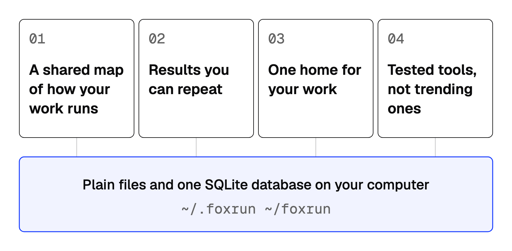
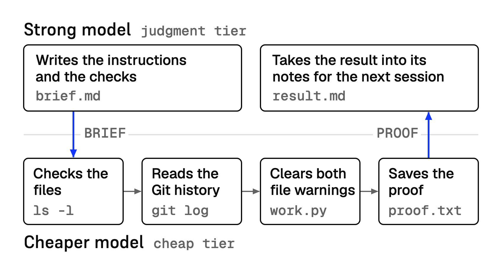
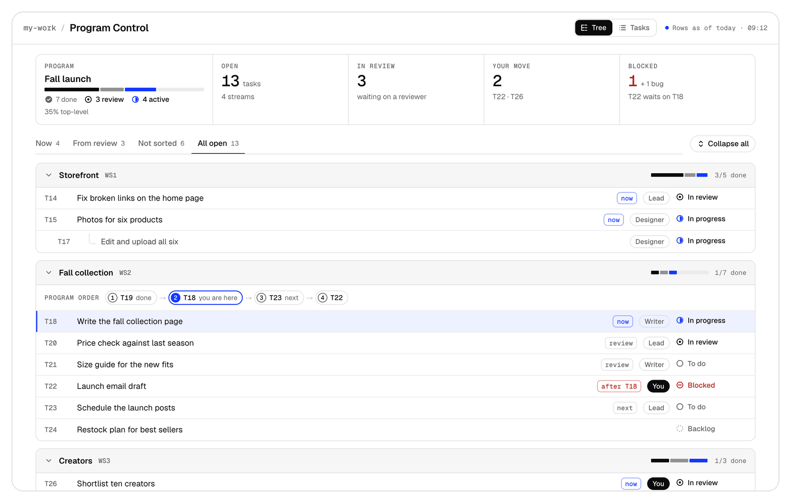
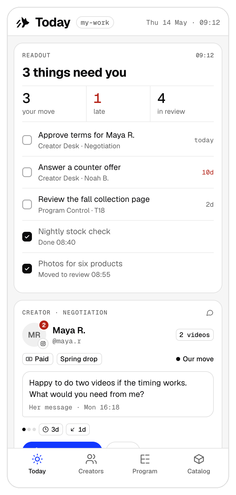
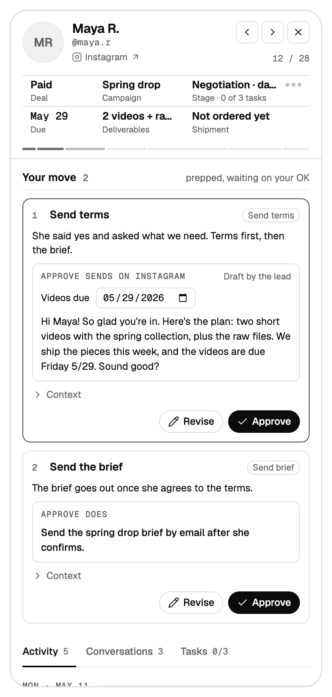
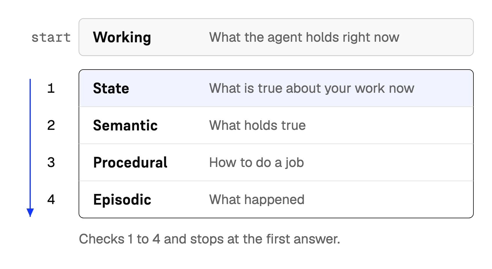
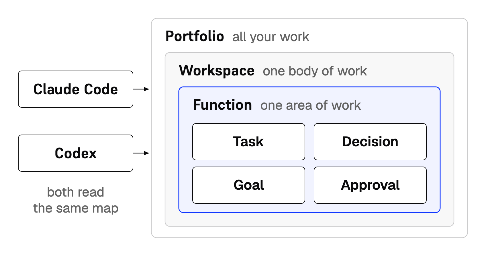
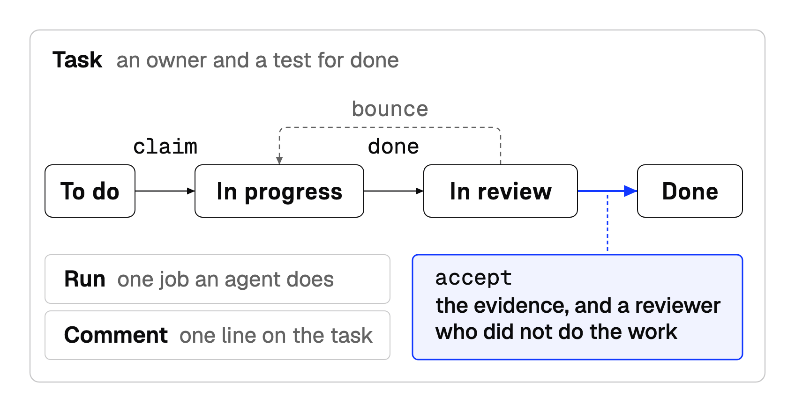

<p align="center"><picture><source media="(prefers-color-scheme: dark)" srcset="assets/readme/banner-dark.png"></picture></p>

# Foxrun

<p align="center"><b>Buy back your week. Foxrun gives your agents the structure to run real work, with real stakes.</b></p>

<p align="center"> </p>

<p align="center"><sub>Version 0.1.0 · MIT · Python 3.9+ · Claude Code and Codex · Tested on macOS · No server, no account</sub></p>

**Foxrun is a headless work OS for your AI agents.** It runs inside the agents you already use, like Claude Code and Codex, with no app to open. Everything lives in plain files and one SQLite database on your computer.

Free and open source. Built by an operator who runs multiple businesses from his phone, with a toddler, twin babies, and no daycare.

<p align="center"><a href="#quick-start">Quick Start</a> · <a href="#the-problem">The problem</a> · <a href="#what-you-get">What you get</a> · <a href="#who-its-for">Who it's for</a> · <a href="#install">Install</a> · <a href="#faq">FAQ</a> · <a href="#why-i-built-it">Why I built it</a></p>

## Quick Start

> [!TIP]
> Paste this into Claude Code, Codex, or any agent that can run commands on your computer. Claude Code and Codex also get a titled thread for each agent; other agents get the install and the skills.

```text
Set up Foxrun for me. Foxrun is an agent team and the structure it runs on: what my business is made of, where each lives, how work moves. That structure lives in plain files and one database on this computer.

1. Install Foxrun with uv: `uv tool install git+https://github.com/foxrun-ai/foxrun`. If uv is missing, install it first. Then read INSTALL.md at github.com/foxrun-ai/foxrun.
2. Ask me three things, one at a time. Use your question tool if you have one, with your pick first:
   - my first name, as one word
   - the name of my first workspace, in lowercase with dashes (for example my-work)
   - which agent I use: Claude Code, Codex, both, or another
3. Run `foxrun install` with my answers, as INSTALL.md shows. Show me the doctor result. If a step fails, stop and show me the error.
4. Run the `foxrun-setup` skill to finish. It offers my Chief of Staff and a lead thread for my workspace first, then the other agents.

Never move, edit, or delete my existing files. Ask me before anything that costs money, sends a message, or changes an outside account.
```

Install takes three commands, and the last one prints this page. It is the real start page from the sample workspace, cut for length:

```text
$ python3 ~/.foxrun/foxrun.py start --workspace my-work
Person: you
Workspace: my-work

OPEN TASKS        1
BLOCKED           0
WAITING FOR YOU   0
OPEN BUGS         0
NIGHTLY           no run yet · GitHub backup none
```

Every line comes from your files and your database, not from a memory of a chat. Your agent starts every session here, so it knows what is open, what is blocked, and what waits for you.

## The Problem

You want agents to solve real problems in your business, your ops, and your life. You don't know where to start.

And once you do start, the same problems show up.

### <picture><source media="(prefers-color-scheme: dark)" srcset="assets/readme/icons/forget-dark.svg"></picture> Your agents forget

- Every morning you open a new session, and it starts from zero.
- Or you nurse one session that never dies. It drifted long ago, and you're praying your trail of markdown files saves you at the right moment.
- You don't know where your state lives: what's next, what's blocked, how it rolls up to your goals.
- You can only see your work from your desk.
- The same mistakes come back, because nothing turns them into lessons the next session reads.
- Your agents write too much. Notes pile up until nobody, you or your agents, can find the one that matters.

### <picture><source media="(prefers-color-scheme: dark)" srcset="assets/readme/icons/swing-dark.svg"></picture> Your results swing

- The same ask gets a different answer each time, because judgment does work that code should do.
- You burn through your quota while the model rereads messy data and redoes finished work.
- One agent does everything, because you haven't split the job into specialized workers.
- Nothing runs while you're away, so every output waits on you.

### <picture><source media="(prefers-color-scheme: dark)" srcset="assets/readme/icons/sprawl-dark.svg"></picture> Your setup sprawls

- Your work lives across a dozen apps, chats, and folders, with no one home for it.
- You build every piece yourself, from zero.
- You don't know when to make a skill, and the ones you make don't hold up.
- You try every new wrapper tool, when Claude Code, Codex, or Hermes already does the job. *(No shade to the other harnesses. These are just the three I live in.)*
- You still pay for SaaS apps and vibe-coded AI wrappers you could replace with your own data.
- You're stuck on one runtime. A new model comes out, and switching means starting over.
- Claude Code and Codex each keep their own settings, skills, and hooks, and you can't see them side by side.

### <picture><source media="(prefers-color-scheme: dark)" srcset="assets/readme/icons/keep-up-dark.svg"></picture> You can't keep up

- New models and tools ship every week, and you hear about them late or not at all.
- The noise is loud and the signal is thin, so you can't tell which tools are worth your time.
- When something good does ship, you don't know how to fit it into your setup.

## What You Get

Foxrun gives your agents the structure they're missing.

<p align="center"><picture><source media="(prefers-color-scheme: dark)" srcset="assets/readme/four-answers-dark.png"></picture></p>

### A shared map of how your work runs

- **Where things stand, at a glance.** Your agents know what's next, what's blocked, and how it rolls up to your goals.
- **Close the tab, keep the work.** A hook prints your start page when a session starts and after each compact.
- **One home for every record.** Tasks, decisions, goals, and approvals each have one home, and every agent reads the same map.
- **Stop losing what you already know.** A memory framework keeps what you know: wiki pages that cite their sources, handoffs, and lessons from your corrections.
- **Memory in five layers.** What the agent holds now, what's true now, what holds true, how to do each job, and what happened each live in their own place, so an agent reads only what it needs.
- **A nightly memory pass (yes, it dreams).** Every night, a job on your Mac checks your pages and memory, compiles your sources, rebuilds your start page, and copies your records to plain files, so you wake up to what needs you.
- **Lean by default.** A lint check keeps every page short and in the right place, so the one that matters stays easy to find.

### Results you can repeat

- **Code makes the calls.** Rules live in code, so they give the same result every time and use no model. Every task has to say what "done" looks like, and the tracker won't create one that doesn't.
- **A starter agent team.** Seven agents keep the system running: the Keeper keeps memory working, and the Toolsmith keeps your tools alive. Add specialists for your own work as you grow, with one command for Claude Code and Codex.
- **Same steps, every run.** Squads and review flows run multi-step work the same way every time.
- **Parallel work, kept apart.** Every worker run gets its own folder, so agents working side by side never write over each other.
- **Tokenomics, built in.** Each job gets a model tier, from judgment down to cheap, set in one file. Out of the box, a cheaper model drafts and rechecks the work, and the strong model gives the final verdict, so your usage limit goes further.

<p align="center"><picture><source media="(prefers-color-scheme: dark)" srcset="assets/readme/code-decides-dark.png"></picture></p>

### One home for your work

- **Everything in one place.** All of it lives in plain files and one SQLite database on your computer.
- **Switch agents without starting over.** Hand any job to Claude Code or Codex, and switch when a new model lands.
- **One config for every agent.** One file, `config/models.yaml`, sets which model does each job on Claude Code and Codex. The same skills and hooks install into both.
- **Fewer subscriptions.** Replace subscriptions with mini apps and dashboards built on your own data (starter kit coming).

### Tested tools, not trending ones

- **Tools that held up on real work.** I tested hundreds of agent tools on real work, and the tool guide keeps the ones that held up, the ones I use every day. Each guide names its cost and a check to run before you trust it.
- **New tools, vetted first.** The `capability` skill searches skills, CLIs, and MCP servers, compares them, and checks their security, then waits for your yes before it installs anything.

### Mini apps, built on Foxrun

<p align="center"><picture><source media="(prefers-color-scheme: dark)" srcset="assets/readme/mini-program-control-dark.png"></picture></p>
<p align="center"><sub>Program Control: your goals, down to every task</sub></p>

<table>
<tr>
<td width="50%" align="center"><picture><source media="(prefers-color-scheme: dark)" srcset="assets/readme/mini-today-dark.png"></picture><br><sub>Today: what needs you right now</sub></td>
<td width="50%" align="center"><picture><source media="(prefers-color-scheme: dark)" srcset="assets/readme/mini-personal-crm-dark.png"></picture><br><sub>Personal CRM: your people and follow-ups, on your own data</sub></td>
</tr>
</table>

<p align="center"><sub>Sample data. My own apps look like this, on my real business.</sub></p>

I run dashboards and small apps on my own Foxrun data, and I check them from my phone and iPad. They are not in the install. A starter kit is coming.

## Who it's for

Operators who run real work and want their agents to carry more of it. You don't need to be an engineer.

You're a fit if you're:

- **A solopreneur** and want a team without hiring one.
- **An employee** and want agents to take real work off a job you already do well.
- **A small business owner** and want to scale with agents before you add headcount.
- **A leader at an enterprise** and want to try an agent team on your own work first.
- **A consultant or fractional exec** and want to deliver like a firm, on your own.
- **A parent with no time** and want the work to keep moving through bedtime. *(Ask me how I know.)*

Or you just want to see how a few people can run real work, with real stakes, at scale.

You use Claude Code or Codex, or you're about to start.

**Not for** people who want a chat bot or a hosted app.

> [!NOTE]
> **Use ChatGPT or Claude in the browser?** A chat window can't run Foxrun. Paid ChatGPT plans include Codex, and paid Claude plans include Claude Code. Either one can.

## Why I built it

I started my career as a technical product manager and became a chief product officer. I'm an operator, not an engineer. Before AI, I built enterprise interoperability solutions that moved health data between organizations for millions of patients.

I've always been obsessed with doing more with less. I built a productivity tool for healthcare, and I've tested just about every one out there: Notion, Asana, Jira, and the rest. Somewhere along the way it clicked. Every one of them is a screen on top of a data model. Get the data model right, and the screen matters a lot less.

I used ChatGPT and Claude from the day they came out. Then, in late 2025, two things happened at once. My twins were born, and coding agents took a real leap with Claude Opus 4.5. I was on parental leave with a two-year-old, two newborns, and a lot of time to experiment.

My problem was simple. How do I deliver the same output I did before they were born, with one hand? I could not sit at a desk to drive every agent. I needed work that ran without me watching, and a record I could trust when I came back. After a lot of trial and error, I landed on what every tool I'd tested runs on: a data model for the work.

A lot of people use personal agents for tedious, low-stakes jobs: ordering groceries, scheduling meetings, taking notes, research. Those are good jobs to hand off, but for me they're the tip of the iceberg. I want end-to-end execution while I'm sleeping. At the end of the day, we're all searching for more time for family, friends, hobbies, adventure, and new bets.

We're all looking for leverage. We're all looking to buy time. Foxrun is how I buy mine.

## Install

You need Python 3.9 or newer, and Claude Code or Codex. Install is tested on macOS. The Linux and Windows commands are written but not yet tested.

Install makes two new folders, `~/.foxrun` and `~/foxrun`, and moves none of your files. Both folders must be empty or absent.

**The easy way:** paste the setup prompt from [Quick Start](#quick-start) into your agent. It installs Foxrun with uv, asks you three questions, and checks the result.

<details>
<summary><b>Other ways to install</b>: Claude Code plugin, Codex plugin, uv by hand, or from source</summary>

**Claude Code plugin.** Type these two commands in Claude Code:

```text
/plugin marketplace add foxrun-ai/foxrun
/plugin install foxrun@foxrun
```

Then say "run Foxrun setup." The plugin adds three skills: `foxrun-setup`, `thread`, and `foxrun-help`. Setup shows you the install commands and runs them on your yes.

**Codex plugin.** Run these two commands in Terminal, then ask Codex to run Foxrun setup:

```sh
codex plugin marketplace add foxrun-ai/foxrun
codex plugin add foxrun@foxrun
```

**uv, by hand.** No plugin and no copy of the code. You need [uv](https://docs.astral.sh/uv/).

```sh
uv tool install git+https://github.com/foxrun-ai/foxrun
foxrun install --home "$HOME/.foxrun" --portfolio "$HOME/foxrun" --yes --person your-name --workspace my-work --runtime both
python3 "$HOME/.foxrun/foxrun.py" doctor
python3 "$HOME/.foxrun/foxrun.py" start --workspace my-work
```

On Windows PowerShell, use `py -3` in place of `python3`.

**From source, for developers.** Get the code, then run the three install commands from its folder. Keep the code in its own folder, never in `~/foxrun`.

macOS and Linux:

```sh
git clone https://github.com/foxrun-ai/foxrun foxrun-source
cd foxrun-source
python3 install.py --home "$HOME/.foxrun" --portfolio "$HOME/foxrun" --yes --person your-name --workspace my-work --runtime both
python3 "$HOME/.foxrun/foxrun.py" doctor
python3 "$HOME/.foxrun/foxrun.py" start --workspace my-work
```

Windows PowerShell:

```powershell
git clone https://github.com/foxrun-ai/foxrun foxrun-source
cd foxrun-source
py -3 install.py --home "$HOME/.foxrun" --portfolio "$HOME/foxrun" --yes --person your-name --workspace my-work --runtime both
py -3 "$HOME/.foxrun/foxrun.py" doctor
py -3 "$HOME/.foxrun/foxrun.py" start --workspace my-work
```

Replace `your-name` with your first name, as one word. Replace `my-work` with your first workspace, in lowercase with dashes. Use `--runtime claude` or `--runtime codex` for one app.

Hooks print your start page when each session starts and after each compact. Setup asks to connect them; by hand, run `python3 "$HOME/.foxrun/foxrun.py" hookup --runtime both`. It backs up your agent app's settings first, and running it twice changes nothing.

Success looks like this: doctor ends with `Doctor: 0 failed`, and start prints your start page. Then open [GUIDE.md](GUIDE.md) for your first task.

**Want to read the code first?** Start with [INSTALL.md](INSTALL.md), then [DOCUMENTATION.md](DOCUMENTATION.md).

</details>

### Update

Close your agent sessions first. Update keeps your workspaces, tasks, and settings, and it saves a backup before it changes anything.

- **Paste prompt or uv:** run `uv tool upgrade foxrun`, then `foxrun update --home "$HOME/.foxrun"`.
- **A plugin:** a plugin upgrade refreshes only its three skills. Run setup after the upgrade. Setup gives you the two uv commands above.
- **By hand:** in your code folder, run `git pull`, then `python3 foxrun.py update --home "$HOME/.foxrun"`.

Success ends with `Doctor: 0 failed`. If an update stops, keep the backup path that it prints.

## Your first session

Open a session in your workspace folder, `~/foxrun/my-work`. Then say one of these to your agent:

| You say | What happens |
|---|---|
| "Show me my start page. What is open, and what waits for me?" | Your agent reads your start page and gives you the open work. |
| "Make a task to check the first delivery. Ask me what done looks like." | Your agent writes a tracked task, with a check that proves it is done. |
| "Save this link to my library: <a link>" | Capture saves the page as a source in Atlas, your shared library. |
| "Find a tool that reads my Gmail. Vet it before you install anything." | The capability skill finds candidates, checks their security, and waits for your yes. |
| "Write a handoff so my next session picks up here." | Your agent writes a short restart note that points at your live tasks. |

## Under the hood

This section is the full inventory, for readers who want the detail.

### The data model

Foxrun keeps your work in one SQLite database, `data.db`, on your computer. The database has four levels. Here is the work module, as the model is designed.

```text
work                module
├── strategy        collection: goal, program
├── metrics         collection: measure, measure-observation
├── operations      collection: project, task, run
├── responsibility  collection: function
├── topic           collection: theme
├── issues          collection: bug, incident
└── activity        collection: comment, attachment, link
```

- **Module:** a group of tables for one part of your work. Every table belongs to exactly one module.
  - Work, memory, events, and decisions are core modules. Add-on modules plug in the same way.
- **Collection:** groups related object types by what they are for.
  - Strategy holds goals and the programs that chase them.
  - Operations holds the doing: projects, tasks, and runs.
- **Object type:** one kind of thing you track, with its own purpose and rules.
  - A task is one unit of work. It can stand alone or belong to a project.
- **Fields:** what each object type records.
  - A task has a title, an owner, a deadline, and a status.
  - The status is one pick from a fixed list: backlog, todo, in-progress, blocked, in-review, done, canceled, or superseded.
  - Other fields hold text, a number, a date, a yes or no, or a link to another record. Links cross modules.

Every agent reads the same rows. My phone dashboards read them too. Once the model is right, the screen is the easy part.

### How memory works

Foxrun is a second brain your agents share. They keep five kinds of memory, and each has one home.

<p align="center"><picture><source media="(prefers-color-scheme: dark)" srcset="assets/readme/memory-layers-dark.png"></picture></p>

| Memory | What it holds | Where it lives |
|---|---|---|
| Working | What the agent holds right now | The start page that `foxrun.py start` prints |
| State | What is true about your work now | Tables in `data.db`: tasks, approvals, runs. `STATE.md` is the readout. |
| Semantic | What holds true | Pages in `wiki/`, `GLOSSARY.md`, and the `decisions` table |
| Procedural | How to do a job | `AGENTS.md` files, skills in `skills/`, and the `lessons` table |
| Episodic | What happened | `history/`: handoffs, snapshots, daily pages, and `LOG.md`. Past sessions too. |

When an agent needs something, it checks state first, then semantic, procedural, and episodic memory, and stops at the first answer. Raw sources and search come last. So it reads only what it needs.

Foxrun also keeps lessons, sources, evidence, and rollups as rows. Your saved sources compile into cited topic pages, with no model and no network.

### What runs on it

- **Memory.** Lessons load every session, and saved sources compile into cited pages. [How memory works](#how-memory-works) covers the five kinds.
- **Program control.** Plan work as programs, themes, and tasks. Every run is recorded, and bugs and incidents get their own tracker.
- **Workflows.** Multi-agent runs, written as files. Research runs three independent researchers and merges their evidence. Review runs a draft, a routine read, a recheck, and a judgment read, with up to three repairs.
- **Squads.** Named teams that staff a workflow. Each role gets its own runtime, model tier, and effort, so one squad can mix Claude and Codex.
- **Orchestration.** Route rules for handing a job from one agent to another, such as Claude Code to Codex, with a check that every brief cites its sources.

### Where everything lives

<p align="center"><picture><source media="(prefers-color-scheme: dark)" srcset="assets/readme/how-foxrun-works-dark.png"></picture></p>

Foxrun's structure lives in two folders.

#### `~/.foxrun`: the system

Foxrun's code, its rules, your settings, and one database. An update replaces the product files here and keeps your settings, your rows, and every `.local` file.

```text
~/.foxrun/            the system
├── agents/           the seat file of each agent
├── config/           your settings: gates, models, words
├── work/             program control: programs, tasks, runs, approvals, bugs
├── memory/           lessons, sources, and the start page every session reads
├── events/           the log of who changed what, and when
├── capture/          saves a link as a source
├── hooks/            runs at session start and around a compact
├── skillwright/      the product skills and the release tool
└── data.db           your rows: tasks, decisions, approvals, lessons
```

#### `~/foxrun`: your portfolio

Your work: one workspace for each business or body of work, plus Atlas, your shared library. An update leaves it alone.

```text
~/foxrun/             your portfolio
├── atlas/            your library: every source you save, compiled into cited pages
└── my-work/          one workspace: one business or body of work
    ├── AGENTS.md     the rules for agents in this workspace
    ├── STATE.md      the start page
    ├── history/      handoffs, daily notes, and kept outputs
    ├── notes/        living pages for your work
    ├── wiki/         what your business knows
    └── raw/          sources as they arrived
```

[DOCUMENTATION.md](DOCUMENTATION.md) gives one line for every file and folder.

### See your work

Your work is plain files and one SQLite database, so any editor can open it. Point Obsidian or VS Code at `~/foxrun` and read every page.

You never need a database tool to see your rows. Foxrun turns your tables into Markdown pages: `ops/DASHBOARD.md` for the whole workspace, and one page for each function.

I check mine from my phone, and from my iPad when I need more screen real estate. Your pages are plain files, so they open anywhere you can reach them: a private link through Tailscale or Cloudflare, an artifact in Claude, a site in Codex, or a local HTML page (on desktop).

<details>
<summary><b>Key commands</b></summary>

You rarely type these, because your agent runs them for you. Say the left column to your agent. Paste the right column into Terminal when you want to check something yourself.

In the table, `work.py` is short for `python3 "$HOME/.foxrun/work/work.py" --workspace my-work --receipt-root "$HOME/foxrun/my-work"`. On Windows PowerShell, use `py -3` in place of `python3`.

| You say to your agent | What it runs |
|---|---|
| "Where do we stand?" | `python3 "$HOME/.foxrun/foxrun.py" start --workspace my-work` prints your start page: open tasks, blocked work, and what waits for you. |
| "Check my install." | `python3 "$HOME/.foxrun/foxrun.py" doctor`. Success ends with `Doctor: 0 failed`. |
| "Update Foxrun." | `uv tool upgrade foxrun`, then `foxrun update --home "$HOME/.foxrun"`. It keeps your work. [Update](#update) gives the command for each route. |
| "What did I decide about shipping?" | `python3 "$HOME/.foxrun/foxrun.py" rulings shipping` |
| "Show me task T1." | `work.py show T1` prints its status, its owner, and its acceptance check. |
| "Make a task to check the first delivery." Later: "T1 is done. Sign it off." | To make it: `work.py create --title "Check the first delivery" --by <your-name>`, plus the six fields every task carries. [GUIDE.md](GUIDE.md#make-your-first-task) shows the full command. To close it: `work.py done T1 --proof <file> --note "<one line>" --by <agent-name>`, then `work.py accept T1 --by <your-name>`. Whoever did the work cannot sign it off. |
| "Write our returns guide, and have another agent check it." | `python3 "$HOME/.foxrun/work/flow.py" run review --input job="Write a one-page guide to our returns rule" --input bar="Plain words, one page, every step numbered"`. A reader checks the work, and the builder fixes it, up to three times. By default it uses both Claude Code and Codex; with only one, see [review.md](skillwright/workflows/review.md). |

</details>

### Skills

A skill is the steps your agent follows for one job. Type the command, or ask for the job in your own words.

<table>
<tr><th colspan="2" align="left">Run the work</th></tr>
<tr><td valign="top"><code>/orient</code></td><td>Shows where you stand, what needs you, and the next move<br><i>Reads the live tracker, not a summary</i></td></tr>
<tr><td valign="top"><code>/task</code><br><code>/bug</code></td><td>Keep every job on one list<br><i>Checks for a duplicate first. Whoever did the work cannot sign it off, enforced in code</i></td></tr>
<tr><td valign="top"><code>/checkpoint</code></td><td>Saves your place mid-session<br><i><code>/handoff</code> reads it</i></td></tr>
<tr><td valign="top"><code>/handoff</code></td><td>Writes the restart note<br><i>Built on live queries, then checked against the session so nothing you settled gets dropped</i></td></tr>
<tr><td valign="top"><code>/close</code></td><td>Seals the day<br><i>Sweeps loose ends, writes the receipts, writes the handoff</i></td></tr>
<tr><th colspan="2" align="left">Think it through</th></tr>
<tr><td valign="top"><code>/grill</code></td><td>Stress-tests a plan<br><i>One question at a time until every branch is decided</i></td></tr>
<tr><td valign="top"><code>/decide</code></td><td>Makes the call<br><i>Sizes it first: a two-way door gets a fast answer, a one-way door slows down</i></td></tr>
<tr><td valign="top"><code>/spec</code></td><td>Writes the plan down<br><i>Lands in <code>specs/</code> where every agent finds it</i></td></tr>
<tr><th colspan="2" align="left">Your agents</th></tr>
<tr><td valign="top">Seven starter agents</td><td>Chief of Staff, Architect, Keeper, Scout, Skillwright, Toolsmith, Adviser<br><i>Each gets its own titled thread</i></td></tr>
<tr><td valign="top"><code>/flow</code></td><td>Runs a named team on one job<br><i>One model builds, a different model reviews, up to three fix rounds</i></td></tr>
<tr><td valign="top"><code>/orchestrate</code></td><td>Hands work to another model<br><i>One menu for Claude and Codex</i></td></tr>
<tr><th colspan="2" align="left">Memory and knowledge</th></tr>
<tr><td valign="top"><code>/recall</code></td><td>Answers from what you already know<br><i>Walks a memory ladder (state, meaning, how-to, history) and stops at the first answer</i></td></tr>
<tr><td valign="top"><code>/capture</code></td><td>Saves a link to your library<br><i>Gets pages other tools can't: blocked pages come back from the archives, and X and Instagram read without an API key</i></td></tr>
<tr><td valign="top"><code>/lesson</code></td><td>Turns a mistake into a rule<br><i>Every agent reads it at start</i></td></tr>
<tr><th colspan="2" align="left">Research and reading</th></tr>
<tr><td valign="top"><code>/read</code></td><td>Pulls any source into the chat<br><i>Web, X, YouTube, a whole repo, a PDF. Saves nothing</i></td></tr>
<tr><td valign="top"><code>/summarize</code></td><td>Boils down video, audio, and files</td></tr>
<tr><td valign="top"><code>/research</code></td><td>Answers a question with sources<br><i>Rejects any quote that is not in the page it fetched. Deep mode sends a team of agents</i></td></tr>
<tr><th colspan="2" align="left">Your browser and apps</th></tr>
<tr><td valign="top"><code>/browse</code></td><td>Drives a real browser as you: clicks, forms, screenshots, scraping<br><i>Uses sessions you are already signed into. It never types a password</i></td></tr>
<tr><td valign="top">Your apps</td><td>Gmail, Apple Notes, Reminders, and iMessage<br><i>Each behind your yes</i></td></tr>
</table>

<sub><b>Built on:</b> <code>/browse</code> runs on Garry Tan's gstack browser. <code>imessage</code> and <code>reminders</code> run on Peter Steinberger's <code>imsg</code> and <code>remindctl</code>. <code>/read</code> uses repomix, yt-dlp, and instaloader. Each is in the <a href="OPTIONAL-ADDONS.md">tool guide</a> with what it costs.</sub>

All 62 skills, and the few that need an Add-on: [SKILLS.md](SKILLS.md).

### Tools

Foxrun installs no outside tools. The [tool guide](OPTIONAL-ADDONS.md) covers two dozen tools I use every day, each tested on real work: research, reading the web, driving your browser and Mac, design, memory, texts and email, secrets, and running a team of agents. The guide names what each one costs, and each tool's page gives a check to run before you trust it. When you need a new one, the `capability` skill does what I do: it searches skills, CLIs, MCP servers, and libraries, compares them, checks their security, and waits for your yes before it installs anything.

## Your data stays yours

Everything lives on your machine, in plain files and one local database. Your files are plain text, so Git can keep their history. Nothing is stored in a Foxrun app, because there isn't one.

**What your agents may do, and what waits for you.** The rules in [`config/gates.md`](config/gates.md) tell every agent to show you the exact thing and wait for your yes. That covers money, a message in your name, a change to an outside account, and a deploy. A yes covers one action, in the version you saw. Agents never print or commit a secret, and secret files stay closed. A delete happens only after a checked backup.

- **Nobody grades their own work.** Every change is a task. The tracker refuses a sign-off from the agent that did the task, owns it, or claimed it. A task closes only with proof attached.

  <p align="center"><picture><source media="(prefers-color-scheme: dark)" srcset="assets/readme/every-task-checked-dark.png"></picture></p>

- **Your yes on anything risky.** A yes covers one action, in the exact version you saw. Your agent saves it as a row, in your words.
- **Your history in Git.** Your files are plain text, so Git keeps their history. The starter rules in [`config/git.md`](config/git.md) tell agents to commit their own work, in the repo that owns the file.

> [!IMPORTANT]
> These are rules your agent reads, not a lock. Your agent app's own permission settings still apply. To report a security problem, see [SECURITY.md](SECURITY.md).

## Limits

Foxrun is early, at version 0.1.0. Here is what it does not do yet:

- **Tested on macOS only.** The Linux and Windows commands are written but not yet tested.
- **The nightly job runs on a Mac only.** On Linux and Windows, install skips it.
- **Claude Code and Codex only.** Other agents can run the install and read the skills, but they get no threads.
- **Hermes: the parts ship, the install doesn't wire them yet.** Foxrun ships Hermes hooks and agent bindings, and I run Hermes every day. The installer sets up only Claude Code and Codex today.
- **No dashboards and no business connections.** The install connects none of your business accounts and ships no business packs. The dashboards on this page are mine; a starter kit is coming.
- **No remove command.** [INSTALL.md](INSTALL.md#remove-an-install) shows how to remove an install by hand.

## FAQ

### What is Foxrun?
Foxrun is a headless work OS for your AI agents. It runs inside the agents you already use, like Claude Code and Codex. It gives your agents a map of your work (goals, numbers, owners, tasks), with your approvals, and a shared toolkit. Everything lives in plain files and one SQLite database on your computer.

### How is Foxrun different from a CLAUDE.md file and a notes folder?
A notes folder holds what you wrote. Foxrun adds a tracker that every agent reads: tasks with proof, your approvals as rows, and lessons from your corrections. Your agent starts every session on the start page, so it knows what is open, what is blocked, and what waits for you.

### What does it cost?
Foxrun is free and open source, under the MIT license. You pay for your own agent: a Claude plan for Claude Code, or a ChatGPT plan for Codex. A few optional tools cost money, and the [tool guide](OPTIONAL-ADDONS.md) names each one's cost.

### Does my data leave my computer?
Foxrun has no server and no account, so your files and your database stay on your computer. Your agent app still sends what it reads to its own model, as it does in any session. Foxrun goes online only for things you ask for or set up, such as a link you give `capture` to read, or a nightly Telegram message you turn on.

### Can my team use it?
Not yet. One install belongs to one person on one computer, and every gate waits for that person's yes. For now, your team is your agents.

### Do I need a Mac?
A Mac is the tested route. The Linux and Windows commands are written but not yet tested. The nightly job runs on a Mac only, and install skips it on Linux and Windows.

## Documentation

- [INSTALL.md](INSTALL.md): every install route, step by step.
- [GUIDE.md](GUIDE.md): your first ten minutes with Foxrun.
- [DOCUMENTATION.md](DOCUMENTATION.md): what each part of Foxrun does.
- [SKILLS.md](SKILLS.md): every skill, and the Add-on a few need.
- [OPTIONAL-ADDONS.md](OPTIONAL-ADDONS.md): the tool guide.
- [SECURITY.md](SECURITY.md): how to report a security problem.

## Feedback and support

- **Found a bug?** Open an issue with the bug report template, or ask your agent to write one up with your `doctor` output. 
- **Want a feature?** Open an issue with the feature request template.
- **Have a question or an idea?** Start a thread in [Discussions](https://github.com/foxrun-ai/foxrun/discussions). 
- **Found a security problem?** Report it privately, as [SECURITY.md](SECURITY.md) shows. Never in a public issue.

## License

MIT License.
